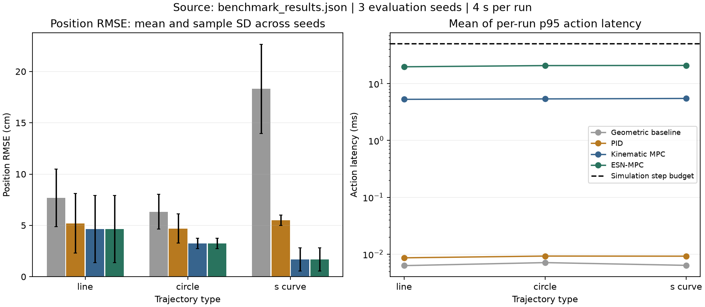
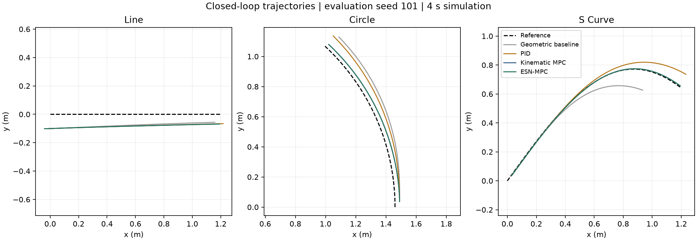

# ESN-MPC for Differential-Drive Trajectory Tracking

A simulation study of an echo state network (ESN) used as the dynamics predictor inside a bounded nonlinear model predictive controller (MPC). The experiment compares learned-model MPC with nominal kinematic MPC, a geometric baseline, and PID on line, circle, and S-curve references.

This is a **repaired publication edition of a graduation-thesis project**. The original simulator, trajectory generator, baseline, PID, and ESN implementation provide the starting point. Training/evaluation and MPC integration were repaired for this release; the benchmark below was regenerated on 16 October 2026 and is **not a reproduction of historical thesis performance claims**. See [RELEASE_NOTES.md](RELEASE_NOTES.md).



## Run the experiment

Checked with Python 3.12.14 on macOS arm64. A fresh Python 3.12 environment is recommended.

```bash
python3.12 -m venv .venv
source .venv/bin/activate
python -m pip install -r requirements.txt
python -m unittest -v test_core
python experiment.py --output results
```

On Windows, activate with `.venv\Scripts\activate`. No saved model, ROS installation, GPU, or external dataset is required. The run generates its own training and validation data and retrains the ESN.

For a shorter smoke run:

```bash
python experiment.py --quick --output results/quick
```

The quick profile uses a smaller reservoir, shorter horizon, fewer training trials, and shorter tracking runs. Its numbers should not be compared directly with the checked-in standard benchmark.

Generated outputs are `benchmark_results.json` (settings, versions, source hashes, per-run metrics, summaries), `benchmark_trajectories.json` (reference and actual paths for the first evaluation seed), and two PNG figures. Generated run directories are ignored by Git. The root-level results and figures in this repository are the checked-in standard benchmark.

## Method

The state is `[x, y, heading]`; the control is `[linear_velocity, angular_velocity]`. An Euler kinematic simulator advances the state every 0.05 s, with linear velocity bounded to `[0, 0.6]` m/s and angular velocity to `[-1.5, 1.5]` rad/s.

The ESN learns **body-frame state increments**, with angular increments represented as sin/cos. Its reservoir weights remain fixed; ridge regression fits the readout. The standard experiment uses 80 reservoir units, spectral radius 0.8, leak rate 0.5, connectivity probability 0.15, ridge coefficient 0.0005, and 10 washout steps per trial. Input noise of standard deviation 0.01 is applied in standardized coordinates during fitting. Angle pairs are decoded to physical units before unit-circle normalization.

MPC rolls the predictor forward over 8 steps (0.4 s). Four control blocks reduce the decision to 8 scalar variables. L-BFGS-B solves the bounded problem, with a shifted previous solution as its warm start. The objective penalizes future position error, periodic heading error, and changes in control; the terminal stage receives double weight. The measured state and applied action update the ESN reservoir after each decision.

The kinematic MPC ablation uses the same optimizer, weights, horizon, action bounds, and initialization. Only its dynamics predictor changes. Baseline and PID use the next waypoint; MPC receives the full future reference horizon, so their information budgets differ.

## Experimental protocol

- Training: 12 independent simulation trials, 120 transitions each, seed 0; 1,440 transitions total. Scaling statistics use training data only. Reservoir state resets and washout restarts at every trial boundary.
- Validation: 6 new trials, seed 1000; 720 transitions from the same generator distribution. One-step prediction uses observed state history; 20-step autoregressive windows begin with a cold reservoir.
- Tracking: 3 trajectory families × 3 evaluation seeds (101, 202, 303) × 4 controllers = 36 runs. Each run lasts 80 steps (4 s). Controllers share the exact reference and perturbed initial state within each trajectory/seed case.
- Error: position RMSE is the root mean squared Euclidean distance in metres; heading differences are wrapped before RMSE. The common initial state is excluded. Error bars show sample standard deviation across the three evaluation seeds, not confidence intervals.
- Timing: action latency includes controller decision and, for ESN-MPC, its observer update. It excludes plant stepping, training, and plotting. The plot averages each run's p95 latency across seeds. Optimizer status and the fraction of decisions exceeding 50 ms are saved for every run.

## Observations from the checked-in run

Mean position RMSE across the three evaluation seeds:

- Line: ESN-MPC **4.64 cm**, kinematic MPC **4.64 cm**, PID **5.20 cm**.
- Circle: ESN-MPC **3.23 cm**, kinematic MPC **3.23 cm**, PID **4.70 cm**.
- S-curve: ESN-MPC **1.68 cm**, kinematic MPC **1.68 cm**, PID **5.49 cm**.

The ESN closely approximates the simulated dynamics: held-out one-step position RMSE is approximately 0.00000557 m; 20-step cold-start rollout position RMSE is approximately 0.0000717 m. These small prediction errors concern an ideal, noiseless simulator and do not establish real-world accuracy.

**The learned predictor provides no demonstrated tracking advantage over the exact kinematic model in this experiment.** ESN-MPC also costs more computation: the mean of per-run p95 action latencies is approximately 19.7–20.8 ms, versus 5.3–5.5 ms for kinematic MPC on this machine. One of 720 ESN-MPC decisions exceeded the 50 ms simulation budget. All MPC optimizer calls reported convergence in the saved run. This is not a hard real-time guarantee.



## Scope and limitations

This is an ideal kinematic simulation, with direct state observations and no motor dynamics, sensor noise, actuator delay, or hardware validation. Because the simulator equals the nominal model, residual targets against that model are zero; residual learning is disabled in the published benchmark. The ESN genuinely predicts increments rather than receiving an exact nominal update as an additive shortcut.

There is one training seed and one reservoir seed; the three evaluation seeds vary reference geometry and initial perturbations. Runs are short, gains are fixed rather than systematically tuned, and validation is from the same generator family. Large line errors can persist because the robot cannot reverse and the predictive horizon is short. Longer runs, model mismatch, disturbances, additional training seeds, and matched-information comparisons remain useful extensions.

The project demonstrates simulation, sequential prediction, ridge regression, constrained optimization, numerical angle handling, and reproducible evaluation.

## Source map

- `robot.py`, `trajectory.py`: plant and reference trajectories.
- `baseline.py`, `pid_controller.py`: comparison controllers and training-data generator.
- `esn_enhanced.py`: ESN fitting, increment decoding, recurrent rollout.
- `mpc.py`: bounded MPC and the nominal kinematic predictor ablation.
- `experiment.py`, `plot_results.py`: one experiment entry point and plots from measured results.
- `test_core.py`: 15 regression tests covering circular errors, train-only scaling, recurrent resets, action-dependent prediction costs, terminal weighting, control bounds, and all-controller execution.

## 中文说明

这是毕业论文代码的公开整理版，研究差速机器人轨迹跟踪、储备池计算与模型预测控制。运行方法、实验设置和结果见上文；实现变更见版本说明。
